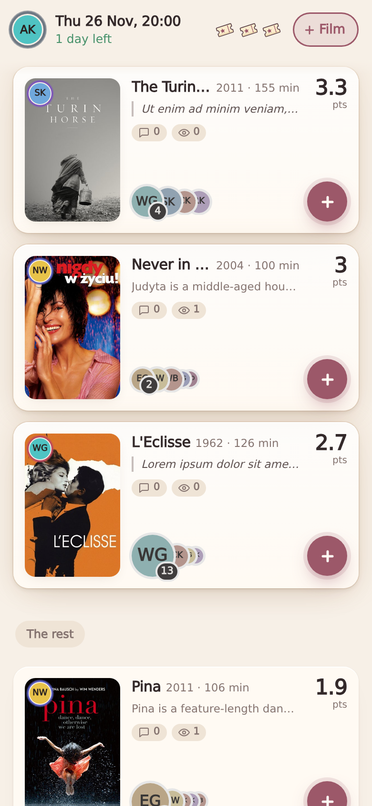

# Wieczorki filmowe

A webapp to manage a weekly film night for my friend group. Everyone nominates one film
a week and gets three voting points that expire unspent. Film scores fade a quarter every
week, so a film nobody keeps backing quietly falls off the list. On Thursday the top three
go to whoever actually turned up in person that given week, and the room picks one. Showing up earns XP and
film-buff ranks.

Polish by default, English on a toggle. Live at **[film.tymek.me](https://film.tymek.me)**,
behind a personal link. There is also a public demo at **[demo.film.tymek.me/demo](https://demo.film.tymek.me/demo)** with an
anonymised copy of the live database, rebuilt every hour. The names, pfps and comments are obfuscated.

  
  
  

## Stack

SvelteKit 2, Svelte 5 runes, the db is a simple sqlite instance. Auth is done through custom login links that get saved to browser storage.
It's a flake, so a release is a push and a `nixos-rebuild`. It uses the TMDB api for movie lookups.

All the info about running is in `docs/` and `CLAUDE.md` (there's script to bootup test servers through tailscale etc). Point your agents to it and they should figure things out (:
