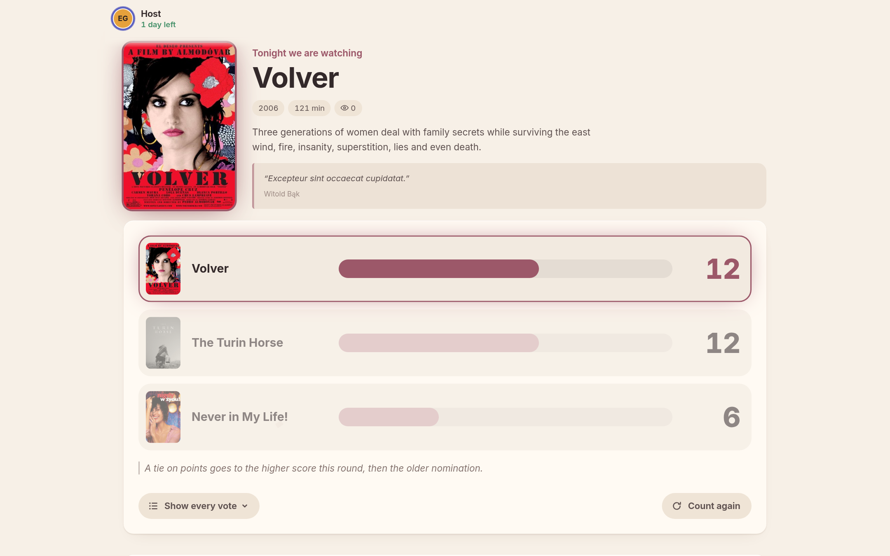
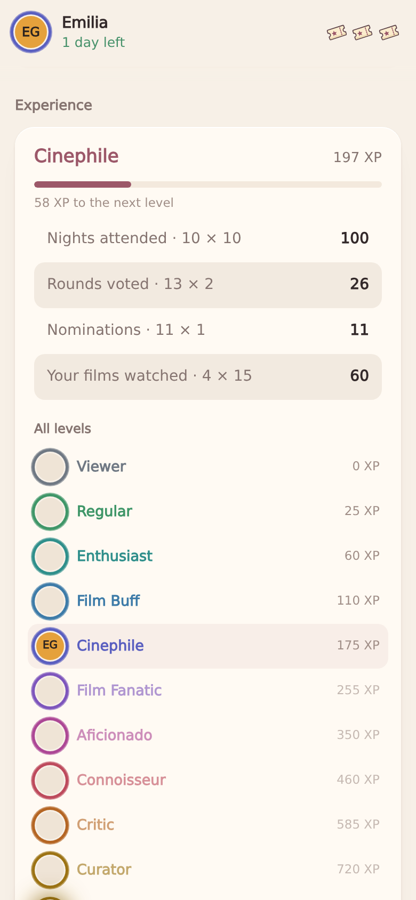

# Wieczorki filmowe

A private site that runs a weekly film night for 22 friends. Everyone nominates one film
a week and gets three voting points that expire unspent. Film scores fade a quarter every
week, so a film nobody keeps backing quietly falls off the list. On Thursday the top three
go to whoever actually turned up, and the room picks one. Showing up earns XP and
film-buff ranks.

Polish by default, English on a toggle. Live at **[film.tymek.me](https://film.tymek.me)**,
behind a personal link.

<p align="center">
  
  
  
</p>

## Stack

SvelteKit 2, Svelte 5 runes, TypeScript, and better-sqlite3 in one process, served by
adapter-node behind Caddy. No ORM, no client state library, no auth provider. The whole
thing is a flake, so a release is a push and a `nixos-rebuild`. 199 tests, no CI, and one
external call: a TMDB lookup when you nominate.

## Four decisions it was built around

**Scores are derived, never accumulated.** `film.score` is a cache with exactly one
writer, `rescoreAll()`, which rebuilds every row wholesale inside the transaction that
touched its inputs. It cannot half-drift, and changing the rule set and restarting is
enough to rescore every week on record correctly.

**The rules screen is generated from the rules.** Change `bankCap` in
`src/lib/server/rules.ts` and the page that explains the rules to people rewrites itself.
There is no prose to forget to update, which is the only version of documentation that
stays true.

**Points buy candidacy; presence buys the choice.** The spec sent a week to a room vote
only on a tie. In practice 22 people nominate and about seven turn up, so the top three
always go to the room now. Nobody is punished for being away: they still nominate, still
spend every point, still decide what is a candidate. They just do not pick the film for a
room they are not in.

**Errors are codes, not sentences.** A rule violation travels to the browser as a code
plus its parameters and is said in the reader's language at the edge. Every string the app
knows lives in two typed dictionaries that a test holds to the same key set, so a new
message cannot ship in one language only.

## Running it

```sh
npm install
cp .env.example .env        # add a TMDB v4 read token
mkdir -p data
npm run seed                # roster, week 1, prints the personal links once
npm run dev
```

`npm test` runs the acceptance suite, `npm run check` typechecks.

## Where things are

| Path | |
|---|---|
| `filmnight-spec.md` | the rules, in full, cited by section from the code |
| `src/lib/server/rules.ts` | the four rule sets: scoring, fade, budgets, ordering |
| `src/lib/server/weeks.ts` | opening, closing, attrition, bank accrual |
| `src/lib/server/runoffs.ts` | the Thursday room vote |
| `src/lib/i18n.ts` | every string the app says about itself |
| `docs/operations.md` | deploying, backups, handing out links |
| `CLAUDE.md` | the invariants, for anyone (or anything) editing this |

This product uses the TMDB API but is not endorsed or certified by TMDB.
